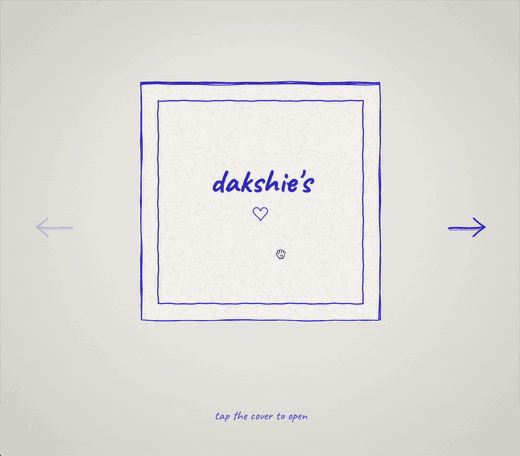

# unfold

A journal you keep inside a hand-drawn pop-up book. Open the cover and the rooms of a little house
fold out one at a time: bedroom, bathroom, kitchen, balcony. Each room has one place to write.

<p align="center">
  <a href="docs/demo.mp4"></a>
</p>

<sub>Click the preview for the full-quality video.</sub>

## Run it

```bash
npm install
npm run dev
```

Open http://localhost:3000.

- **Open / close** the book: click the cover, press Enter or double-click. Esc, or the left arrow on the first room, closes it.
- **Turn rooms:** the side arrows, the arrow keys, or drag sideways.
- **Write:** click the writing spot in the room in front.

## The rooms

| Room | Mood | Where you write |
|------|------|-----------------|
| Bedroom | slow mornings, late-night thinking | the cork board: pin notes |
| Bathroom | resets, mirror talks | the mirror: stick notes on it |
| Kitchen | nourishment, home, people over | the fridge door: notes under magnets |
| Balcony | late nights, the big picture | the diary on the bean bag: a page a day |

Click a spot and the camera moves in on it, then a close-up opens. "Tear out" crumples a note
away; Esc puts a note back, then closes the close-up.

Entries are saved in this browser only (localStorage, `unfold.entries.v1`). Everything goes
through the async functions in `lib/journal.ts`, so moving to a server later only means changing
that file.

## How the folds work

The book is a real pop-up mechanism, worked out in code. There are three folds.

**1. The pages fan out from one spine.**
Every page is hinged on the same vertical spine, like a carousel book. Two neighbouring pages make
one room: they're its left and right walls. Opening the book means spreading the pages round the
spine.

```
        top view                     the room in front gets 90°,
                                     the others share what's left
        page  page
          \   |   /                       \  |  /
           \  |  /                         \ | /    ← folded stacks
            \ | /                     ------ + ------
   page ---- spine ---- page                 |
                                             |  ← open room (90°)
```

The room you're looking at always opens to a right angle. The rest of the half circle is shared out
between the other rooms, with the nearest getting the most room, so far-off rooms fold flat into
stacks on either side. Turning to the next room just moves which room gets the 90°, and every page
slides smoothly to its new angle (`pageAngles` in `lib/fold.ts`).

**2. The floor is a square folded on its diagonal.**
Take a square of paper and crease it corner to corner. Glue one half to the bottom of the left
wall and the other half to the bottom of the right wall, with the crease starting at the spine.

- When the walls are 90° apart, the square lies flat: that's the floor.
- As the walls close, the two halves get pushed together and the crease rises like a tent.
- When the book is shut, the floor stands straight up between the pages, out of the way.

So the floor folds itself away. Nothing has to be animated by hand: the crease's tip is simply the
point that stays the right distance from both walls (`floorApex` in `lib/fold.ts`). With the
walls θ apart and pages of width L, it sits `L / cos(θ/2)` out from the spine and
`√(2L² − (L / cos(θ/2))²)` up. At θ = 90° that height is 0 (flat), and at θ = 0 it's L
(standing up).

**3. The furniture is flat cut-outs.**
Beds, desks and plants are flat paper cards standing on the floor, like the tabs in a pop-up book.
They're drawn in isometric so they look solid from the camera's angle. A card stands up only once
its room has opened fully, and lies flat again as soon as the room starts to fold.

On top of the folds, every surface starts as ink line art and washes with colour as its room comes
to the front, so the open room is coloured and the rest stay sketches.

## How it's built

Next.js (App Router), React Three Fiber, drei and three.js. The handwriting font is Caveat
(`@fontsource/caveat`). There are no image assets: every drawing is generated in code when the page
loads.

| File | What it does |
|------|--------------|
| `lib/fold.ts` | The fold maths: page angles, the floor's crease, where the camera looks. |
| `lib/sketch.ts` | A small hand-drawn 2D renderer (wobbly ink lines, watercolour fills, hatching, paper cut-outs) and `bake()`, which turns a drawing into a texture. |
| `lib/iso.ts` | Draws furniture in isometric for the pop-up cards. |
| `lib/rooms.ts` | The drawings for every wall, floor and pop-up, plus the covers. |
| `lib/style.ts` | Colour helpers for the soft wash. |
| `lib/paperMaterial.ts` | Shader: paper grain, the colour reveal, soft light, pen hatching on shaded faces. |
| `lib/textures.ts` | Bakes every surface once the font has loaded. |
| `lib/spots.ts` | The writing spot in each room: its name, prompt and close-up style. |
| `lib/journal.ts` | Saving and loading entries. |
| `lib/store.ts` | Animation state shared between the controls and the 3D scene. |
| `components/Book.tsx` | The 3D scene: pages, folding floors, pop-ups, clickable spots, camera. |
| `components/Experience.tsx` | Canvas, controls (arrows, keys, drag), captions. |
| `components/Closeup.tsx` | The close-up writing views (cork board, mirror, fridge, diary). |
| `components/Crumple.tsx` | The crumple-and-fade animation when a note is torn out. |

## Branches

- `main`: the journal.
- `wedding-invite`: the same book turned into a wedding invitation, with one room per event and an
  RSVP.

## License

[MIT](LICENSE)
